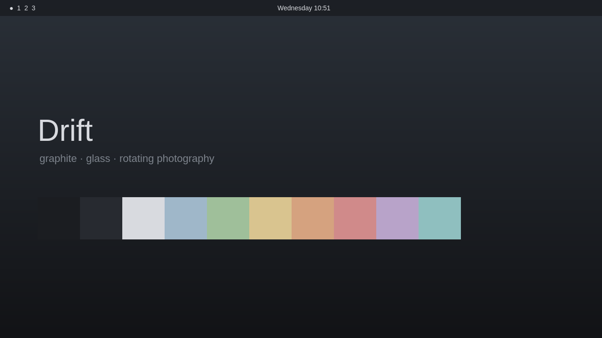

# Drift — an Omarchy theme



A clean, neutral graphite theme for [Omarchy](https://omarchy.org) built to sit
quietly over a wallpaper that keeps changing.

- **Glass bar**: a slim, translucent graphite bar (best with
  `omarchy bar background glassy`), with hairline-bordered menus, popups,
  notifications and lock screen.
- **Colours from the wallpaper**: every time the background changes, Drift
  recolours itself from the image using [Aether](https://github.com/bjarneo/aether)'s
  palette extraction: terminals, borders, bar, menus and all. Without Aether
  it falls back to a calm graphite palette with a glacier-blue accent.
- **Rotating photography**: `drift-wallpaper` pulls a random, high-resolution
  landscape photo from [Wallhaven](https://wallhaven.cc) every two hours.

## Install

Everything (theme, wallpaper fetcher, timer, wallpaper-matched colours, glassy bar):

```bash
curl -fsSL https://raw.githubusercontent.com/Pieter-Uys/omarchy-drift-theme/main/install.sh | bash
```

Or from a clone:

```bash
git clone https://github.com/Pieter-Uys/omarchy-drift-theme.git
./omarchy-drift-theme/install.sh   # --no-glassy --no-timer --no-apply --no-recolor
```

Theme only (fixed graphite palette, no wallpaper rotation):

```bash
omarchy theme install https://github.com/Pieter-Uys/omarchy-drift-theme
```

Re-running `install.sh` updates an existing install. `omarchy theme update`
also pulls the latest version.

## Wallpapers

`drift-wallpaper` asks Wallhaven for:

- SFW only (`purity=100`) in the General category (no anime or people)
- tagged `photography` plus one of: landscape, nature, mountains, lake, sea,
  forest, clouds, snow, desert, coast
- at least 2560×1440, in 16:9, 16:10 or 21:9
- ranked by all-time favourites, random page and pick

Images are saved to `~/.config/omarchy/backgrounds/drift/` (the newest 20 are
kept), so `omarchy theme bg next` cycles through them. The background only
changes while Drift is the active theme.

No wallpapers are shipped in this repo: they belong to their photographers on
Wallhaven.

```bash
drift-wallpaper                                     # fetch and apply a new one now
drift-wallpaper --no-apply                          # fetch only
systemctl --user disable --now drift-wallpaper.timer  # stop rotating
```

## Colours from the wallpaper

`drift-recolor` runs `aether --generate <wallpaper> --no-apply`, writes the
extracted palette to the theme's `colors.toml`, renders `shell.toml` from
`extras/shell.toml.tpl`, and re-applies Drift without touching the wallpaper.
A systemd path unit runs it whenever the background changes, whether from the
timer, `omarchy theme bg next` or the background picker. It only acts while
Drift is the active theme.

```bash
drift-recolor            # recolour from the current wallpaper
drift-recolor --force    # redo it even if this image was already used
drift-recolor --reset    # back to the graphite palette
systemctl --user disable --now drift-recolor.path   # stop auto-recolouring
```

The installer marks `colors.toml` and `shell.toml` with git's skip-worktree
flag, so the generated colours stay out of `git status` and don't get in the
way of `omarchy theme update`. If the repo's default palette itself ever
changes, re-run `install.sh` instead: it restores those two files before
pulling and recolours afterwards.

## Files

| File | Purpose |
|------|---------|
| `colors.toml` | Palette; Omarchy generates terminal, editor and Hyprland colours from it |
| `shell.toml` | Bar, menus, popups, notifications, lock screen styling |
| `icons.theme` | Icon theme (Yaru-blue) |
| `extras/drift-wallpaper` | Wallhaven fetcher, with its systemd service and timer |
| `extras/drift-recolor` | Wallpaper-to-palette recolouring, with its path unit and service |
| `extras/shell.toml.tpl` | Shell styling template that `drift-recolor` fills in |
| `install.sh` | One-shot installer |
