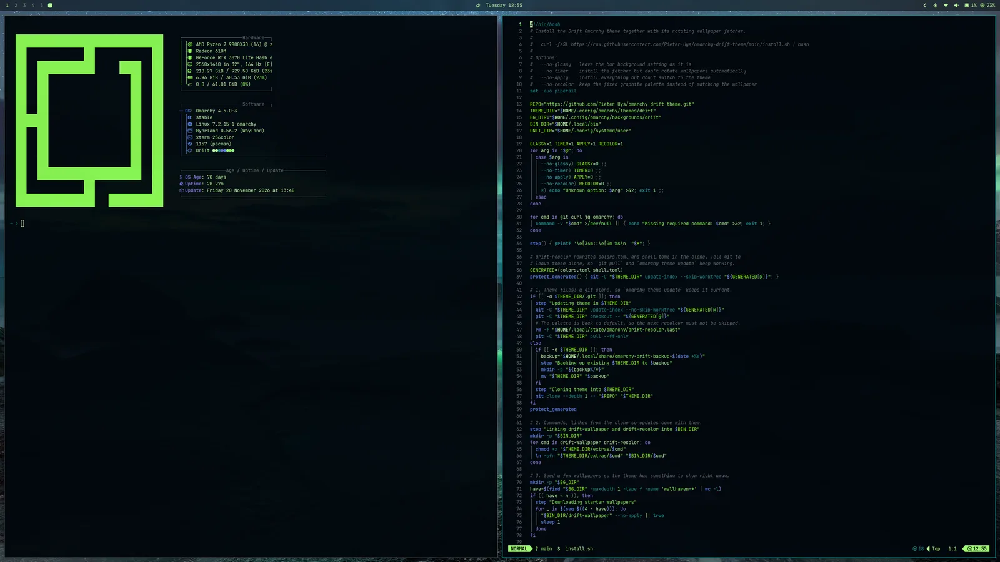

<div align="center">

# Drift

**A calm graphite Omarchy theme that recolours itself to match a wallpaper that keeps changing.**


[Install](#install) · [Uninstall](#uninstall) · [Guarantees](#what-drift-will-and-wont-do) · [Wallpapers](#wallpapers) · [Colours](#colours-from-the-wallpaper) · [Files](#files) · [License](#license)



</div>

---

A clean, neutral graphite theme for [Omarchy](https://omarchy.org) built to sit quietly over a wallpaper that keeps changing.

## Features

| | |
|---|---|
| **Glass bar** | A slim, translucent graphite bar (best with `omarchy bar background glassy`), with hairline-bordered menus, popups, notifications and lock screen |
| **Colours from the wallpaper** | Every time the background changes, Drift recolours terminals, borders, bar and menus from the image using [Aether](https://github.com/bjarneo/aether)'s palette extraction |
| **Graphite fallback** | Without Aether, a calm graphite palette with a glacier-blue accent |
| **Rotating photography** | `drift-wallpaper` pulls a random, high-resolution landscape photo from [Wallhaven](https://wallhaven.cc), by hand or every two hours with `--timer` |

## Install

**Just the theme** (fixed graphite palette and the bundled gradient wallpaper), the way Omarchy installs any theme:

```bash
omarchy theme install https://github.com/Pieter-Uys/omarchy-drift-theme
```

**The full Drift** adds the wallpaper fetcher, wallpaper-matched colours and the glassy bar. It reuses an existing theme install:

```bash
curl -fsSL https://raw.githubusercontent.com/Pieter-Uys/omarchy-drift-theme/main/install.sh | bash
```

Add `-s -- --timer` to also rotate the wallpaper every two hours:

```bash
curl -fsSL https://raw.githubusercontent.com/Pieter-Uys/omarchy-drift-theme/main/install.sh | bash -s -- --timer
```

<details>
<summary><b>Other ways to install</b></summary>

<br>

From a clone, with optional flags:

```bash
git clone https://github.com/Pieter-Uys/omarchy-drift-theme.git
./omarchy-drift-theme/install.sh   # --timer --no-glassy --no-apply --no-recolor
```

| Flag | Effect |
|---|---|
| `--no-glassy` | Leave the bar background setting as it is |
| `--timer` | Also rotate the wallpaper every two hours (a timer you already have is kept on re-install) |
| `--no-timer` | Remove the rotation timer; `drift-wallpaper` still works by hand |
| `--no-apply` | Install everything but don't switch to the theme |
| `--no-recolor` | Keep the fixed graphite palette instead of matching the wallpaper |
| `--uninstall` | Remove Drift and everything the installer added (see [Uninstall](#uninstall)) |

</details>

Re-running `install.sh` updates an existing install. `omarchy theme update` also pulls the latest version.

## Uninstall

```bash
curl -fsSL https://raw.githubusercontent.com/Pieter-Uys/omarchy-drift-theme/main/install.sh | bash -s -- --uninstall
```

This switches back to the theme you had before Drift (or Matte Black), then removes the systemd units, the `drift-wallpaper` and `drift-recolor` commands, the theme and the downloaded wallpapers in `~/.config/omarchy/backgrounds/drift`. It is safe to run twice, and it also tidies up after `omarchy theme remove drift`.

## What Drift will and won't do

Drift runs in the background, so these rules are part of its contract. Each one is checked by a case in [`tests/run.sh`](tests/run.sh).

| Drift will never… | Test |
|---|---|
| re-apply itself while another theme is active | `recolor_not_drift`, `wallpaper_other_theme` |
| interrupt a theme switch you've started | `recolor_switching` |
| change your wallpaper when recolouring | `recolor_red` (`skip_bg=1`) |
| keep recolouring the same wallpaper in a loop | `recolor_skips_same_wallpaper`, `recolor_reset` |
| replace working colours with a broken palette (failures keep the current colours) | `recolor_aether_fails`, `recolor_aether_empty` |
| delete the wallpaper on screen when pruning old downloads | `wallpaper_prunes_old` |
| leave anything behind on `--uninstall`, or delete a `drift-*` command that isn't its own | `uninstall`, `uninstall_keeps_users_own_command` |
| rotate wallpapers unless you asked for `--timer` | `install_fresh`, `install_timer_opt_in` |

What `install.sh` changes on your system: a git clone in `~/.config/omarchy/themes/drift`, two links in `~/.local/bin`, up to four systemd user units in `~/.config/systemd/user`, a few state files in `~/.local/state/omarchy`, wallpapers in `~/.config/omarchy/backgrounds/drift`, and (unless `--no-recolor`) the Aether package from the AUR. It downloads four starter photos from Wallhaven, and more only when you run `drift-wallpaper` or enable `--timer`. "SFW" is Wallhaven's own rating.

<details>
<summary><b>Why a crash mid-recolour heals itself</b></summary>

<br>

`colors.toml` and `shell.toml` are each written to a temporary file and moved into place, then the wallpaper is noted in `drift-recolor.last`. A crash between those steps leaves the note stale, so the next wallpaper event recolours again and brings both files back in step.

</details>

## Wallpapers

`drift-wallpaper` asks Wallhaven for:

- SFW only (`purity=100`) in the General category (no anime or people)
- tagged `photography` plus one of: landscape, nature, mountains, lake, sea, forest, clouds, snow, desert, coast
- at least 2560×1440, in 16:9, 16:10 or 21:9
- ranked by all-time favourites, random page and pick

Images are saved to `~/.config/omarchy/backgrounds/drift/` (the newest 20 are kept), so `omarchy theme bg next` cycles through them. The background only changes while Drift is the active theme.

> The only wallpaper shipped in this repo is `backgrounds/1-graphite.jpg`, a gradient made from Drift's palette. Photos are never bundled: they belong to their photographers on Wallhaven.

| Command | Description |
|---|---|
| `drift-wallpaper` | Fetch and apply a new one now |
| `drift-wallpaper --no-apply` | Fetch only |
| `install.sh --timer` / `--no-timer` | Start or stop rotating every two hours |

## Colours from the wallpaper

`drift-recolor` runs `aether --generate <wallpaper> --no-apply`, writes the extracted palette to the theme's `colors.toml`, renders `shell.toml` from `extras/shell.toml.tpl`, and re-applies Drift without touching the wallpaper. With ImageMagick installed, the accent is the palette colour closest to the wallpaper's dominant hue.

A systemd path unit runs it whenever the background changes, whether from the timer, `omarchy theme bg next` or the background picker. It only acts while Drift is the active theme.

| Command | Description |
|---|---|
| `drift-recolor` | Recolour from the current wallpaper |
| `drift-recolor --force` | Redo it even if this image was already used |
| `drift-recolor --reset` | Back to the graphite palette |
| `systemctl --user disable --now drift-recolor.path` | Stop auto-recolouring |

<details>
<summary><b>How the generated colours stay out of git</b></summary>

<br>

The installer marks `colors.toml` and `shell.toml` with git's skip-worktree flag, so the generated colours stay out of `git status` and don't get in the way of `omarchy theme update`. If the repo's default palette itself ever changes, re-run `install.sh` instead: it restores those two files before pulling and recolours afterwards.

</details>

## Files

| File | Purpose |
|---|---|
| `colors.toml` | Palette; Omarchy generates terminal, editor and Hyprland colours from it |
| `shell.toml` | Bar, menus, popups, notifications, lock screen styling |
| `icons.theme` | Icon theme (Yaru-blue) |
| `backgrounds/1-graphite.jpg` | Default wallpaper: a graphite gradient made from the palette |
| `extras/drift-wallpaper` | Wallhaven fetcher, with its systemd service and timer |
| `extras/drift-recolor` | Wallpaper-to-palette recolouring, with its path unit and service |
| `extras/shell.toml.tpl` | Shell styling template that `drift-recolor` fills in |
| `install.sh` | One-shot installer |
| `preview.png` | Palette swatch shown in the Omarchy theme picker |
| `screenshot.webp` | The screenshot at the top of this README |
| `tests/run.sh` | Characterization tests (run in CI on every push) |

## License

MIT. See [LICENSE](LICENSE); that includes the bundled gradient wallpaper. `tests/vendor/omarchy-theme-color` is Omarchy's, under [its MIT licence](tests/vendor/LICENSE-omarchy). Wallpapers fetched from Wallhaven belong to their photographers and are not covered by this licence.
